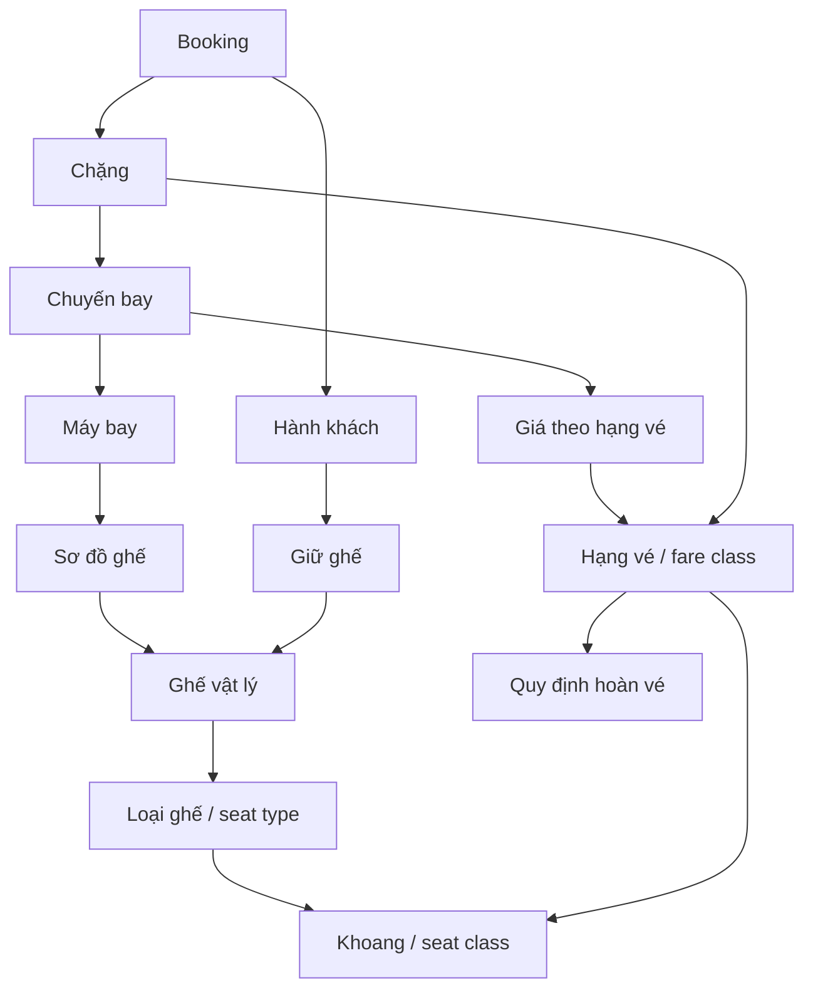
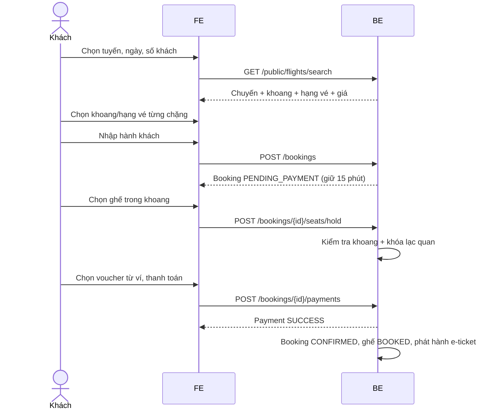

# 09 — Nghiệp vụ toàn dự án (Phase 1–3)

> **Ngày:** 14/11/2026
> **Mục đích:** một tài liệu nghiệp vụ duy nhất, đọc là hiểu toàn bộ hệ thống bán vé.
> **Quy ước:** ✅ đang áp dụng · 🔧 đề xuất sửa · ❓ chờ chốt.
> **Nguồn:** API v0.4, DB v0.5, migration V1–V16, Permission v2.1, use case 3 phase, các quyết định đã chốt khi duyệt wireframe.

---

## 0. Mô hình Khoang – Hạng vé – Loại ghế (đã chốt 14/11/2026)

Mô hình đúng là 3 tầng độc lập:

| Tầng | Tên nghiệp vụ | Trả lời câu hỏi | Ví dụ |
|---|---|---|---|
| 1 | **Khoang** (`seat_class`) | Khách được ngồi khu nào trên máy bay? | Phổ thông · Phổ thông đặc biệt · Thương gia |
| 2 | **Hạng vé** (`fare_class`) | Khách mua gói giá và điều kiện nào? | Tiết kiệm · Tiêu chuẩn · Linh hoạt |
| 3 | **Loại ghế** (`seat_type`) | Ghế đó có đặc tính gì và phụ thu bao nhiêu? | Tiêu chuẩn · Cửa sổ · Lối đi · Hàng đầu · Thoát hiểm |

### Quyết định đã chốt

| # | Quyết định | Trạng thái |
|---|---|---|
| **Q1** | **Bỏ khoang Hạng nhất (`FIRST`)** — dự án nội địa không khai thác. Chỉ mở lại khi mở rộng bay quốc tế. | ✅ đã sửa BE |
| **Q2** | Mỗi khoang có **nhiều hạng vé** (Saver / Standard / Flex…), không phải 1 hạng/khoang. | ✅ đã seed BE |
| **Q3** | **Phụ thu gắn với loại ghế**, không gắn với việc đổi khoang. | ✅ đã sửa BE |
| **Q4** | **Phổ thông có nhiều loại ghế** để chọn (tiêu chuẩn, cửa sổ, lối đi, hàng đầu, thoát hiểm). | ✅ |
| **Q5** | **Phổ thông đặc biệt và Thương gia chỉ có một loại ghế chuẩn, miễn phí** — ghế đã xịn sẵn. | ✅ |
| **Q6** | Khách mua hạng vé thuộc khoang nào thì **chỉ thấy và chọn được ghế khoang đó**; backend kiểm tra lại khi giữ ghế. | ✅ đã ghi trong wireframe + tài liệu |
| **Q7** | **Bỏ hoàn toàn `seat_class_surcharges`** và màn "Phụ thu nâng hạng". Đổi khoang = đổi hạng vé. | ✅ đã xoá BE + wireframe |

### Ba lỗi cũ đã được sửa

| # | Lỗi cũ | Cách sửa |
|---|---|---|
| **L1** | `seat_class` chỉ có `ECONOMY / BUSINESS / FIRST`; `PREMIUM_ECONOMY` là hạng vé ánh xạ xuống `ECONOMY` | V16 thêm `PREMIUM_ECONOMY`, bỏ `FIRST` khỏi CHECK |
| **L2** | `seat_class_surcharges` cho phép vé Phổ thông trả thêm tiền để ngồi ghế Thương gia | V16 xoá bảng; đổi khoang = đổi hạng vé |
| **L3** | Phụ thu chưa nằm ở loại ghế | V16 thêm `seat_types.surcharge` |

### Quy tắc vận hành

1. **Khoang** là cabin vật lý. Mỗi ghế trên máy bay thuộc đúng một khoang, suy ra từ loại ghế. Máy bay có 2 khoang thì chỉ có 2.
2. **Hạng vé** là sản phẩm bán trong một khoang. Hạng vé quyết định giá và điều kiện hoàn–đổi.
3. **Loại ghế** là đặc tính ghế trong khoang; phụ thu nằm ở đây và có thể ghi đè theo chuyến (`flight_seats.seat_surcharge`).
4. Đổi khoang là **đổi hạng vé**, tính lại giá và điều kiện. Không có phụ thu đổi khoang.
5. Backend kiểm tra khoang khi giữ ghế, không chỉ ẩn trên UI.
6. Trẻ em trả 100% phụ thu ghế; em bé không có ghế.

---

## 1. Actor và phạm vi

| Actor | Làm gì | Không được làm |
|---|---|---|
| **GUEST** | Xem chuyến, giá, khuyến mãi, tin tức; tra cứu đặt chỗ bằng mã + email/SĐT | Tạo booking |
| **CUSTOMER** | Đặt vé, nhập hành khách, chọn ghế trong khoang đã mua, mua hành lý, thanh toán, xem/hủy vé của mình, nhận voucher vào ví | Xem dữ liệu người khác; đổi khoang bằng phụ thu ghế |
| **STAFF** | Quản lý chuyến bay, hạng vé, giá, tồn ghế; xem đặt chỗ; dashboard vận hành | Quản lý user/RBAC/master data |
| **ADMIN** | Toàn quyền: master data, user, RBAC, khuyến mãi, voucher, tin tức, cấu hình ghế | Thanh toán hộ, gán ghế hộ |

Role cố định: `CUSTOMER / STAFF / ADMIN`. Mỗi user đúng một role.

---

## 2. Mô hình sản phẩm bán vé

### 2.1 Sơ đồ khái niệm



Điểm nối quan trọng: **hạng vé và loại ghế đều trỏ về cùng một khoang**. Vì vậy hệ thống luôn kiểm tra được khách có đang chọn ghế đúng khoang đã mua hay không.

### 2.2 Khoang (`seat_class`)

- Là **khu vực vật lý** trên máy bay, có vách ngăn/dịch vụ riêng.
- Ba khoang dùng cho vé nội địa:
  - Phổ thông (`ECONOMY`)
  - Phổ thông đặc biệt (`PREMIUM_ECONOMY`)
  - Thương gia (`BUSINESS`)
- **Không có Hạng nhất (`FIRST`)** — chỉ mở lại khi mở rộng bay quốc tế.
- Máy bay có thể chỉ khai 2 khoang (Phổ thông + Thương gia).
- Khoang của ghế **suy ra từ loại ghế**, không nhập riêng trên từng ghế.

### 2.3 Hạng vé (`fare_class`)

- Là **sản phẩm thương mại** khách mua trong một khoang.
- Quyết định giá vé (`flight_fares`), điều kiện hoàn/đổi (`fare_rules`), phạm vi khuyến mãi/voucher.
- Một khoang có **nhiều hạng vé**. Seed hiện tại:

| Khoang | Hạng vé | Điều kiện hoàn |
|---|---|---|
| Phổ thông | `ECON_SAVER` | Không hoàn |
| Phổ thông | `ECON_STANDARD` | Hoàn 80% · trước 24h |
| Phổ thông | `ECON_FLEX` | Hoàn 90% · trước 24h |
| Phổ thông đặc biệt | `PREM_ECO_STANDARD` | Hoàn 85% · trước 24h |
| Phổ thông đặc biệt | `PREM_ECO_FLEX` | Hoàn 95% · trước 24h |
| Thương gia | `BIZ_STANDARD` | Hoàn 90% · trước 24h |
| Thương gia | `BIZ_FLEX` | Hoàn 100% · trước 24h |

> ✅ V16 đã đổi mã hạng vé cũ (`ECONOMY`, `PREMIUM_ECONOMY`, `BUSINESS`) thành mã trên và seed đủ 7 hạng vé + `fare_rules` v1.

### 2.4 Loại ghế (`seat_type`)

- Là **đặc tính của một ghế trong khoang**: tiêu chuẩn, cửa sổ, lối đi, hàng đầu, thoát hiểm.
- Có `color_hex` để tô màu trên sơ đồ và `surcharge` cho phụ thu mặc định.
- **Phổ thông** có nhiều loại ghế; **Phổ thông đặc biệt và Thương gia** chỉ có một loại ghế chuẩn, phụ thu 0.

| Mã | Tên gọi trên máy bay | Khoang | Phụ thu |
|---|---|---|---|
| `ECO` | Ghế tiêu chuẩn | Phổ thông | 0 |
| `ECO_WIN` | Ghế cửa sổ | Phổ thông | 0 |
| `ECO_AIS` | Ghế lối đi | Phổ thông | 0 |
| `ECO_FRONT` | Ghế hàng đầu | Phổ thông | 70.000 |
| `ECO_EXIT` | Ghế thoát hiểm | Phổ thông | 120.000 |
| `PREM_ECO` | Ghế ngả rộng | Phổ thông đặc biệt | 0 |
| `BUS` | Ghế thương gia | Thương gia | 0 |

> ✅ V16 đã thêm `seat_types.surcharge`. `flight_seats.seat_surcharge` vẫn **ghi đè theo từng chuyến** (ví dụ chuyến dài bán ghế thoát hiểm đắt hơn).
>
> ✅ Đã **xoá bảng `seat_class_surcharges`** và màn "Phụ thu nâng hạng". Đổi khoang là đổi hạng vé.

### 2.5 Khoang: set cứng hay CRUD?

**Chốt: set cứng trong code (enum), không CRUD.**

Lý do:
- Số khoang gắn với thiết kế vật lý máy bay và với toàn bộ nghiệp vụ giá vé; thêm khoang là thay đổi schema + logic, không phải thao tác dữ liệu.
- Hiện là enum `SeatClass` (+ CHECK trong DB), có trong mọi câu so sánh khoang khi chọn ghế.
- Màn **Khoang máy bay** vì vậy chỉ **đọc**: xem 3 khoang, số hạng vé, số loại ghế, trạng thái dùng/không dùng. Không có nút Thêm/Sửa/Xóa.
- Khi mở rộng bay quốc tế mới cần thêm `FIRST`: đó là **migration + sửa enum**, không phải bật một nút trên UI.

Việc admin cần thay đổi thật sự là **loại ghế** và **hạng vé** — hai thứ này CRUD đầy đủ.

### 2.6 Ghế trong sơ đồ và tồn ghế

- **Sơ đồ máy bay sinh đủ ghế cho mọi khối đã khai** — không tồn tại ô "không có ghế". Nếu một ghế hỏng hoặc không bán, đó là chuyện của **tồn ghế theo chuyến** (`flight_seats.status = BLOCKED`), không phải sửa sơ đồ.
- Sơ đồ chỉ định nghĩa: ghế nào tồn tại, thuộc khoang nào, loại ghế gì.
- Tồn ghế theo chuyến quyết định: ghế còn bán hay không, phụ thu riêng của chuyến.
- Vì vậy bước **Khóa/mở ghế** và **quản lý ghế hỏng** nằm ở màn `Tồn ghế theo chuyến`, không nằm ở màn sơ đồ.

### 2.7 Hiển thị ghế đã chọn trong đơn nhiều khách

- Một đơn tối đa **9 khách**. Mỗi hành khách được gán **một màu riêng** (bảng 9 màu), dùng đồng thời:
  - chấm màu trên tab hành khách;
  - nền ô ghế đã chọn trên sơ đồ cabin;
  - chú giải màu phía trên lưới.
- Không dùng chung một kiểu "ghế đang chọn / ghế khách khác" nữa — từ 3 khách trở lên kiểu đó không phân biệt được ai ngồi đâu.
- Màu chỉ để phân biệt trong **một đơn**, không mang nghĩa trạng thái ghế. Trạng thái ghế vẫn là: trống / đã có người / khóa.

### 2.8 Khách chọn ghế theo khoang mua

| Khoang của hạng vé | Màn | Khách thấy gì |
|---|---|---|
| Phổ thông | W-RT-05 | 5 loại ghế (tiêu chuẩn, cửa sổ, lối đi, hàng đầu 70k, thoát hiểm 120k), có phụ thu |
| Phổ thông đặc biệt | cùng khuôn W-RT-05a | Một loại ghế ngả rộng, 0 ₫ |
| Thương gia | W-RT-05a | Một loại ghế thương gia, 0 ₫, sơ đồ 2-2 |

Quy tắc chung:

- Chỉ hiện ghế thuộc khoang của hạng vé đã mua.
- Không có danh sách loại ghế ở hai khoang trên — ghế đã xịn sẵn.
- Luôn hiện dòng "Phụ thu ghế" kể cả khi bằng 0 ₫, để khách đối chiếu với trang thanh toán.
- Muốn ngồi khoang khác phải mua hạng vé của khoang đó, không trả thêm phụ thu.

### 2.9 Ràng buộc bắt buộc

1. `seat_type.seat_class` = khoang của ghế.
2. `fare_class.seat_class` = khoang của hạng vé.
3. Khách chỉ được giữ ghế nếu `seat_type.seat_class` = `fare_class.seat_class` của chặng.
4. Không có phụ thu đổi khoang khi chọn ghế.
5. Trẻ em trả 100% phụ thu ghế; em bé không có ghế, không phụ thu.
6. Phụ thu được chụp lại lúc giữ ghế (`seat_holds.surcharge_at_booking`), không đổi sau khi đặt.

### 2.10 Đối chiếu trước – sau khi sửa

| Nội dung | Trước 14/11/2026 | Sau khi sửa (V16) |
|---|---|---|
| Khoang Phổ thông đặc biệt | Không có trong `seat_class`; là hạng vé ánh xạ ECONOMY | Khoang riêng `PREMIUM_ECONOMY` |
| Số hạng vé mỗi khoang | 1 | Nhiều (Saver / Standard / Flex…) |
| Phụ thu chọn ghế | Theo cặp khoang (`seat_class_surcharges`) | Theo loại ghế (`seat_types.surcharge`) + ghi đè theo chuyến |
| Đổi khoang khi chọn ghế | Được phép bằng phụ thu | **Không**; đổi khoang = đổi hạng vé |
| Khách thấy ghế khoang khác | Có | **Không** |
| Khoang FIRST | Có enum, không có hạng vé | Đã bỏ khỏi enum và CHECK |

### 2.11 Việc còn lại

1. **API kiểm tra khoang khi giữ ghế** — chưa có code Phase 2/3, phải nhớ khi làm `POST /bookings/{id}/seats/hold`.
2. **Seed loại ghế theo từng máy bay** — hiện seed chung; khi làm sơ đồ ghế thật cần gán đúng loại cho từng vùng.
3. **FE model `FareClass` / `SeatType.surcharge`** — chưa có, thêm khi làm màn chọn ghế.

---

## 3. Phase 1 — Nền tảng và dữ liệu nền

### 3.1 Xác thực và tài khoản

| Chức năng | Quy tắc |
|---|---|
| Đăng ký | Email + mật khẩu; tài khoản mới là CUSTOMER, trạng thái ACTIVE |
| Đăng nhập | Trả access token + refresh token; sai email/mật khẩu trả cùng một lỗi |
| Đăng xuất | Đưa access token vào blacklist Redis |
| Refresh token | Xoay vòng; token cũ bị vô hiệu |
| Quên mật khẩu | Gửi yêu cầu → nhận token → đặt mật khẩu mới |
| Đổi mật khẩu | Cần đăng nhập; kiểm tra mật khẩu cũ |

**Trạng thái tài khoản:** `ACTIVE` / `INACTIVE`. Tài khoản INACTIVE không đăng nhập được.

### 3.2 Hồ sơ cá nhân

- CUSTOMER/STAFF/ADMIN đều có hồ sơ riêng.
- Trường: họ tên, email, số điện thoại, ngày sinh, giới tính (`MALE/FEMALE/OTHER`), ảnh đại diện.
- Không có giấy tờ tùy thân trong bảng `users`.

### 3.3 Quản lý người dùng (ADMIN)

- Tạo user: bắt buộc chọn role `CUSTOMER/STAFF/ADMIN`.
- Sửa user: đổi role, trạng thái, thông tin.
- Xóa mềm: **không xóa được tài khoản ADMIN**, kể cả chính mình; phải hạ role trước.
- Đặt lại mật khẩu: trả mật khẩu tạm.
- Không có bulk cho user.

### 3.4 RBAC

- 3 role cố định; không tạo/sửa/xóa role trong MVP.
- Quyền gắn vào role qua `role_permissions`.
- Quyền hiển thị theo module; STAFF đọc được master data nhưng không sửa.
- Danh sách quyền và vai trò chỉ đọc.

### 3.5 Dữ liệu nền

| Module | Quy tắc chính |
|---|---|
| Hãng bay | Mã hãng duy nhất; xóa mềm; public chỉ thấy ACTIVE |
| Thành phố | Có ảnh đại diện; dùng cho dropdown sân bay |
| Sân bay | Thuộc một thành phố; mã IATA duy nhất |
| Máy bay | Sức chứa ghế; không đổi máy bay nếu chuyến đã có booking |
| Loại ghế | Thuộc một khoang; có màu; có phụ thu mặc định (đề xuất) |
| Sơ đồ ghế | Mỗi máy bay một sơ đồ; tổng ghế = sức chứa; loại ghế phải ACTIVE |

### 3.6 Cấu hình sơ đồ ghế

- ADMIN khai báo theo khối: hàng từ–đến, danh sách cột, loại ghế.
- Kiểm tra: không trùng `(hàng, cột)`, tổng ghế = `seat_capacity`, loại ghế ACTIVE.
- Lưu là ghi thay thế toàn bộ trong một transaction.
- Không sửa sơ đồ máy bay đã sinh tồn ghế cho chuyến.
- Lưới ghế tô màu theo `seat_types.color_hex`; nếu null thì theo khoang.
- **Khoang của ghế lấy từ loại ghế**, không nhập tay trên từng ghế.

### 3.7 Khuyến mãi (Promotion)

- Giảm thẳng vào **giá dòng vé**, áp tự động khi tạo đơn.
- Khách không nhận, không nhập mã.
- Loại giảm: `PERCENT` hoặc `AMOUNT`.
- Có trần giảm, giá tối thiểu, loại hành trình, phạm vi (hãng/hạng vé/tuyến/chuyến) và danh sách chuyến loại trừ.
- Nhiều khuyến mãi khớp: chọn cái giảm nhiều nhất.
- Không áp cho em bé (INFANT).
- **Không giới hạn lượt dùng mỗi khách (chốt 17/11/2026).** Khuyến mãi áp cho mọi đơn phát sinh trong thời gian chạy; `promotions` không có và **không cần** cột giới hạn/khách. Giới hạn số lượng chỉ tồn tại ở voucher (`claim_limit`).
- Trạng thái: `ACTIVE/INACTIVE`; xóa mềm.

### 3.8 Voucher

- Khách **nhận vào ví**, không gõ mã.
- Hai loại phát hành:
  - `GLOBAL`: xuất hiện trong Kho voucher, khách bấm Nhận; có thể giới hạn lượt phát.
  - `ASSIGNED`: ADMIN tặng riêng; tự xuất hiện trong Ví của tôi.
- Vòng đời trong ví: `AVAILABLE → RESERVED → USED`; hết hạn/hủy booking thì `RESERVED → AVAILABLE`.
- Voucher ASSIGNED không tự nhận được.
- Một booking tối đa một voucher (`user_vouchers.booking_id` UNIQUE).
- Voucher giảm trên **cả booking** sau khi đã áp khuyến mãi.
- Không áp cho em bé.
- **Mỗi khách đúng 1 lần cho mỗi voucher (chốt 17/11/2026).** Giữ ràng buộc `UNIQUE (user_id, voucher_id)` của `user_vouchers`; không mở lại `per_user_limit` (V7 đã xoá). Vì vậy giao diện khách không được hứa "mỗi khách 2 lần".
- **Cộng dồn với khuyến mãi (chốt 17/11/2026):** một đơn vẫn chỉ dùng **một voucher**, nhưng voucher **dùng chung được với khuyến mãi tự động**. Công thức `total_amount` ở `bookings` đã trừ cả hai khoản nên DB đã cho phép sẵn.

### 3.9 Tin tức

- Bài có nhiều chuyên mục.
- Trạng thái: `DRAFT / PUBLISHED / UNPUBLISHED`.
- Phải có ít nhất một chuyên mục trước khi Publish.
- Khách chỉ thấy bài `PUBLISHED`; bài khác trả “không tìm thấy”.
- Nội dung là HTML, phải sanitize hai lớp (BE jsoup, FE DOMPurify).
- Danh mục tin public trả mảng trần `{id, name}`.

### 3.10 Xóa mềm và thao tác hàng loạt

- Mọi bảng master data dùng `is_deleted` + `deleted_at`.
- Mã duy nhất dùng partial unique index `WHERE is_deleted = false`.
- Bulk tối đa 100 id; trả kết quả từng phần `succeeded` / `failed`.
- Bulk đổi trạng thái hoặc xóa mềm; không dùng cho user.

### 3.11 Quy tắc nghiệp vụ Phase 1

| Mã | Quy tắc |
|---|---|
| BR-P1-01 | ADMIN không xóa tài khoản ADMIN; phải hạ role trước |
| BR-P1-02 | Không tạo/sửa/xóa role trong MVP |
| BR-P1-03 | News phải có chuyên mục trước khi publish |
| BR-P1-04 | Khách chỉ thấy dữ liệu `ACTIVE` / bài `PUBLISHED` |
| BR-P1-05 | Update khác Activate/Deactivate |
| BR-P1-06 | Xóa mềm, không xóa cứng dữ liệu nghiệp vụ |
| BR-P1-07 | Sơ đồ ghế phải khớp sức chứa và loại ghế ACTIVE |
| BR-P1-08 | Voucher GLOBAL mới được nhận; ASSIGNED chỉ ADMIN tặng |
| BR-P1-09 | Khuyến mãi tự động; voucher khách tự chọn từ ví |

---

## 4. Phase 2 — Chuyến bay và giá vé

### 4.1 Vòng đời chuyến bay

Hai trạng thái độc lập:

**Vận hành (`operation_status`):**

`DRAFT → SCHEDULED → BOARDING → DEPARTED → ARRIVED`

Nhánh: `DELAYED`, `CANCELLED`.

**Bán (`sales_status`):**

`CLOSED ↔ OPEN`

Quy tắc:

- Chỉ bán khi `sales_status = OPEN` và chuyến chưa cất cánh.
- Chuyến `CANCELLED` không bán, không giữ ghế.
- Chuyến bổ sung dùng `parent_flight_id` trỏ về chuyến gốc.
- Không đổi máy bay nếu chuyến đã có booking.

### 4.2 Tìm chuyến

Tham số bắt buộc: sân bay đi, sân bay đến, ngày đi, số khách, `trip_type`.

Quy tắc:

- Chỉ chuyến `OPEN`, chưa xóa mềm, còn ghế.
- Chỉ bán **bay thẳng**; không có điểm dừng.
- Kết quả trả giá theo từng hạng vé và từng loại hành khách.
- FE lọc client theo: hãng, khoang/hạng vé, giờ khởi hành, khoảng giá.
- Sắp xếp: rẻ nhất, nhanh nhất, sớm nhất, muộn nhất.

### 4.3 Hạng vé trong tìm kiếm

- Mỗi chuyến trả danh sách **hạng vé** kèm khoang.
- Thẻ chuyến chỉ hiện “Giá từ” (thấp nhất trong khoang đang lọc).
- Khách chọn **khoang** trước, sau đó chọn **hạng vé** trong khoang.
- Chọn hạng vé riêng cho từng chặng.

> ✅ Đã áp dụng: bộ lọc là **khoang**, tab trong màn chọn cũng là **khoang**, danh sách bên dưới là **hạng vé**.

### 4.4 Quy định hoàn vé

- Mỗi hạng vé có một hoặc nhiều version `fare_rules`.
- Trường: có được hoàn không, hủy trước bao nhiêu giờ, hoàn bao nhiêu %, mô tả.
- Khi đặt, `booking_segments` chụp `fare_rule_id`; sửa rule sau không ảnh hưởng vé đã bán.
- Hủy vé chỉ hiển thị chính sách; **không tự hoàn tiền**.

### 4.5 Giá bán theo chuyến

- Bảng `flight_fares` lưu giá **người lớn** theo `(flight_id, fare_class_id)` và khoảng hiệu lực.
- `base_fare` + `tax_fee` (thuế và phí gộp).
- Giá trẻ em = 75%, em bé = 10% (cấu hình).
- Không cho hai dòng chồng khoảng hiệu lực cùng chuyến + hạng vé.
- API trả sẵn `adult_price`, `child_price`, `infant_price`.
- Giá vé là **giá trọn gói**, khách không thấy thuế/phí tách rời.

### 4.6 Gói hành lý

- Danh mục gói: tên, số kg, giá, trạng thái.
- Khách mua thêm theo từng hành khách.
- Giá chụp lại lúc đặt (`unit_price_at_booking`).
- Hành lý không thuộc khoang/hạng vé; có thể mua riêng.

### 4.7 Tồn ghế theo chuyến

- Sinh từ sơ đồ ghế của máy bay: mỗi ghế vật lý → một dòng `flight_seats`.
- Trạng thái: `AVAILABLE / HOLD / BOOKED / BLOCKED`.
- `version` khóa lạc quan chống hai người giữ cùng ghế.
- `seat_surcharge` ghi đè phụ thu mặc định của loại ghế cho chuyến đó.
- UNIQUE `(flight_id, seat_code)` và `(flight_id, aircraft_seat_id)`.
- ADMIN/STAFF có thể khóa/mở ghế (`BLOCKED`).

### 4.8 Chọn ghế — mô hình đúng

1. Khách đã mua hạng vé → biết `fare_class.seat_class` (khoang).
2. Mở sơ đồ ghế → **chỉ trả ghế thuộc khoang đó**.
3. Mỗi ghế hiển thị loại ghế + phụ thu.
4. Khách chọn ghế → backend kiểm tra lại khoang.
5. Giữ ghế 15 phút (chốt 17/11/2026; tài liệu cũ ghi 30 phút — đã đồng bộ lại toàn bộ tài liệu và wireframe).
6. Trẻ em trả 100% phụ thu; em bé không chọn ghế.

**Điều không được làm:**

- Không cho vé Phổ thông chọn ghế Thương gia bằng phụ thu.
- Không cho đổi khoang ở bước chọn ghế.
- Không hiển thị ghế khoang khác trên UI.

### 4.9 Quy tắc nghiệp vụ Phase 2

| Mã | Quy tắc |
|---|---|
| BR-P2-01 | STAFF quản lý chuyến/giá/tồn ghế; không sửa master data |
| BR-P2-02 | Chỉ bán chuyến OPEN, chưa cất cánh, còn ghế |
| BR-P2-03 | Không đổi máy bay khi chuyến đã có booking |
| BR-P2-04 | Giá chỉ lưu người lớn; trẻ em 75%, em bé 10% |
| BR-P2-05 | Không chồng khoảng hiệu lực giá cùng chuyến + hạng vé |
| BR-P2-06 | Giữ ghế phải kiểm tra khoang của hạng vé |
| BR-P2-07 | Phụ thu theo loại ghế; ghi đè được theo chuyến |
| BR-P2-08 | Không bán ghế khoang khác với hạng vé |
| BR-P2-09 | Tồn ghế sinh đủ từ sơ đồ máy bay |

---

## 5. Phase 3 — Đặt vé, thanh toán, vé điện tử

### 5.1 Vòng đời booking

`PENDING_PAYMENT → CONFIRMED → CANCELLED`

Nhánh: `PENDING_PAYMENT → EXPIRED` khi hết hạn thanh toán.

Quy tắc:

- Chỉ CUSTOMER tạo booking; GUEST phải đăng nhập.
- Một booking có 1–2 chặng (một chiều / khứ hồi).
- Mỗi chặng có hạng vé riêng.
- Hết hạn thanh toán: giải phóng ghế, voucher RESERVED trả về AVAILABLE.

### 5.2 Hành khách

- Loại: `ADULT` (≥12), `CHILD` (2–11), `INFANT` (<2).
- Tối đa 9 khách; em bé ≤ số người lớn.
- Mỗi hành khách có họ tên, giới tính, ngày sinh; email/SĐT tùy chọn.
- Em bé không có ghế, không có e-ticket ghế.
- Mỗi hành khách nhận e-ticket riêng cho từng chặng.

### 5.3 Giữ ghế

- Giữ tạm **15 phút** kể từ lúc tạo booking.
- `seat_holds` lưu `hold_expires_at`, `surcharge_at_booking`, trạng thái `HOLD/CONFIRMED/RELEASED`.
- Partial unique index chặn hai người giữ cùng ghế.
- Hết hạn: ghế về `AVAILABLE`.
- Hủy booking: ghế về `AVAILABLE`, seat_hold `RELEASED`.
- **Chỉ giữ ghế trong khoang của hạng vé đã mua.**

### 5.4 Công thức giá

**Bước 1 — giá từng dòng vé:**

- ADULT = `base_fare + tax_fee`
- CHILD = ADULT × 75%
- INFANT = ADULT × 10%

**Bước 2 — khuyến mãi (theo dòng vé):**

- Áp promotion thỏa hiệu lực, loại hành trình, phạm vi, giá tối thiểu.
- Chỉ ADULT + CHILD.
- Chọn promotion giảm nhiều nhất.

**Bước 3 — voucher (theo booking):**

- Giảm trên phần sau khuyến mãi của các dòng ADULT/CHILD.
- Đạt `min_order_amount`; tối đa `max_discount_amount`.

**Bước 4 — tổng thanh toán:**

```
total = fare_amount
      − promotion_discount_amount
      − voucher_discount_amount
      + seat_surcharge_amount
      + baggage_amount
```

Quy tắc:

- Phụ thu ghế và hành lý **không** bị giảm bởi khuyến mãi/voucher.
- Mọi con số hiển thị là giá trọn gói đã gồm thuế/phí.
- Giá được chụp lại tại thời điểm đặt.

### 5.5 Thanh toán

Hai phương thức:

1. **VNPay** — chuyển hướng sang cổng thanh toán; không vẽ QR.
2. **Chuyển khoản ngân hàng (VietQR)** — màn riêng có QR, thông tin chuyển khoản, nội dung bắt buộc; tự kiểm tra trạng thái.

Không làm:

- Thẻ tín dụng/ghi nợ.
- Thanh toán tại quầy.

Quy tắc:

- Payment có trạng thái `PENDING/SUCCESS/FAILED`; cho phép thử lại.
- Mỗi giao dịch cổng có mã duy nhất; callback đến hai lần không tạo giao dịch trùng.
- Thanh toán thành công → booking `CONFIRMED`, ghế `BOOKED`, phát hành e-ticket.

### 5.6 Vé điện tử

- Mỗi hành khách + mỗi chặng = một e-ticket.
- Trạng thái `ISSUED/CANCELLED`.
- Em bé không có ghế nhưng vẫn có e-ticket.
- Mã vé duy nhất; PNR dùng chung cả booking.

### 5.7 Hủy vé

- Khách hủy khi booking `CONFIRMED` hoặc `PENDING_PAYMENT`, trước giờ khởi hành chặng sớm nhất.
- Cập nhật booking `CANCELLED`, ghi thời điểm + lý do.
- Giải phóng ghế; e-ticket `CANCELLED`.
- Voucher RESERVED trả về AVAILABLE.
- **Không tự động hoàn tiền.**
- Hiển thị chính sách hoàn từ `fare_rules` để tham khảo; khách liên hệ đại lý.

### 5.8 Thông báo và báo cáo

- `notifications` chưa triển khai; không thiết kế màn phụ thuộc.
- Dashboard vận hành: chuyến, ghế, booking trong ngày.
- Dashboard tổng quan: doanh thu, booking, tỷ lệ lấp đầy.

### 5.9 Quy tắc nghiệp vụ Phase 3

| Mã | Quy tắc |
|---|---|
| BR-P3-01 | GUEST không tạo booking |
| BR-P3-02 | Mỗi booking tối đa một voucher |
| BR-P3-03 | Voucher chỉ chọn từ ví, không nhập mã |
| BR-P3-04 | Giữ ghế 15 phút; hết hạn tự giải phóng |
| BR-P3-05 | Chỉ giữ ghế trong khoang của hạng vé |
| BR-P3-06 | Phụ thu ghế/hành lý không bị giảm giá |
| BR-P3-07 | Hủy vé không tự hoàn tiền |
| BR-P3-08 | Thanh toán chỉ VNPay hoặc chuyển khoản |
| BR-P3-09 | E-ticket phát hành sau khi thanh toán thành công |
| BR-P3-10 | Em bé không có ghế, không phụ thu ghế |

---

## 6. Quy tắc xuyên suốt

### 6.1 Trạng thái

| Đối tượng | Trạng thái |
|---|---|
| Master data / User | `ACTIVE / INACTIVE` |
| News | `DRAFT / PUBLISHED / UNPUBLISHED` |
| Flight vận hành | `DRAFT / SCHEDULED / BOARDING / DELAYED / DEPARTED / ARRIVED / CANCELLED` |
| Flight bán | `OPEN / CLOSED` |
| Booking | `PENDING_PAYMENT / CONFIRMED / CANCELLED / EXPIRED` |
| Seat | `AVAILABLE / HOLD / BOOKED / BLOCKED` |
| Seat hold | `HOLD / CONFIRMED / RELEASED` |
| Payment | `PENDING / SUCCESS / FAILED` |
| E-ticket | `ISSUED / CANCELLED` |
| User voucher | `AVAILABLE / RESERVED / USED / EXPIRED` |

### 6.2 Xóa mềm

- `is_deleted` + `deleted_at`; không xóa cứng dữ liệu nghiệp vụ.
- Mã duy nhất dùng partial unique index.
- Dữ liệu đã xóa không xuất hiện ở public.

### 6.3 Thời gian và tiền

- Thời gian: `TIMESTAMPTZ`.
- Tiền: `NUMERIC(12,2)` VND, không float.
- Giá vé đã gồm thuế/phí.
- Mọi mốc hạn dùng `*_expires_at`.

### 6.4 Bảo mật

- JWT + Redis blacklist/whitelist.
- `@PreAuthorize` ở controller.
- CUSTOMER chỉ thấy dữ liệu của mình.
- STAFF không quản lý user/RBAC/master data.
- ADMIN không xóa ADMIN.

---

## 7. Luồng end-to-end

### 7.1 Khách tìm và đặt vé



### 7.2 Hủy vé

1. Khách bấm hủy.
2. BE kiểm tra trạng thái + giờ khởi hành.
3. Booking `CANCELLED`; ghế `AVAILABLE`; e-ticket `CANCELLED`; voucher trả ví.
4. Không tính tiền hoàn; hiển thị chính sách + liên hệ đại lý.

### 7.3 Vận hành

- STAFF tạo chuyến → gán máy bay đã có sơ đồ → đặt giá theo hạng vé → mở bán → sinh tồn ghế.
- STAFF theo dõi ghế còn lại; mở chuyến bổ sung khi cầu cao.
- STAFF xem booking, không sửa booking.

### 7.4 Quản trị

- ADMIN quản lý master data, user, RBAC, khuyến mãi, voucher, tin tức.
- ADMIN cấu hình khoang/loại ghế/sơ đồ ghế, hạng vé, quy định hoàn.

---

## 8. Trạng thái lỗi/lệch

### 8.1 Đã sửa (nhánh BE `feature/mo-hinh-khoang-hang-ve`, 14/11/2026)

| Vấn đề | Cách sửa |
|---|---|
| Khoang Phổ thông đặc biệt không tồn tại trong `SeatClass` | V16 thêm `PREMIUM_ECONOMY` vào enum + CHECK |
| Đổi khoang bằng phụ thu ghế | V16 xoá bảng `seat_class_surcharges` và toàn bộ module BE |
| Phụ thu chưa gắn loại ghế | V16 thêm `seat_types.surcharge` + DTO/entity/mapper/service |
| Chỉ 1 hạng vé mỗi khoang | V16 seed 7 hạng vé + `fare_rules` v1 |
| FIRST có khoang nhưng không có hạng vé | V16 bỏ `FIRST` khỏi enum và CHECK |
| FE nhãn “hạng ghế” lẫn “hạng vé” | Wireframe khách + admin đổi thành “khoang” và “hạng vé” |
| Admin có màn Phụ thu nâng hạng | Thay bằng màn **Khoang máy bay** (W-ADM-16) |

### 8.2 Còn lại

| Ưu tiên | Vấn đề | Cần làm |
|---|---|---|
| **P0** | API giữ ghế chưa tồn tại | Khi làm Phase 3 phải kiểm tra `seat_type.seat_class = fare_class.seat_class` |
| **P1** | FE mock 8 loại ghế, BE seed 7 | Đồng bộ seed khi nối API |
| **P1** | FE chưa có model `FareClass`/`FlightFare`/`FareRule` | Thêm model + mock Phase 2 |
| — | Giữ chỗ 15 vs 30 phút | **Đã chốt 15 phút (17/11/2026)** — tài liệu và wireframe đồng bộ xong; code đọc `payment_expires_at` do BE trả về, không hard-code |
| **P2** | `voucher-store` FE/BE lệch shape | FE sửa sang mảng trần |
| **P2** | `my-vouchers` dùng `Voucher` đầy đủ | Tách `VoucherBrief`, bỏ `discount_amount` |

---

## 9. Thuật ngữ

| Thuật ngữ | Nghĩa trong dự án |
|---|---|
| **Khoang / cabin** | Khu vực vật lý trên máy bay; `seat_class` |
| **Hạng vé / fare class** | Sản phẩm giá + điều kiện trong một khoang |
| **Loại ghế / seat type** | Đặc tính ghế trong khoang; nơi đặt phụ thu |
| **Chuyến bay / flight** | Một lần khai thác theo số hiệu + giờ |
| **Chặng / segment** | Một chiều của booking; khứ hồi có 2 chặng |
| **Giữ ghế / hold** | Khóa tạm một ghế trong 15 phút |
| **PNR / booking code** | Mã đặt chỗ dùng chung cả booking |
| **E-ticket** | Vé điện tử theo hành khách + chặng |
| **Promotion** | Khuyến mãi tự động trên giá vé; không giới hạn lượt/khách |
| **Voucher** | Ưu đãi khách nhận vào ví và chọn khi thanh toán; mỗi khách 1 lần, cộng dồn được với khuyến mãi |
| **Fare rule** | Quy định hoàn/đổi của hạng vé |

---

## 10. Liên kết

- Tổng quan dự án: [01-tong-quan.md](01-tong-quan.md)
- Kiến trúc: [02-kien-truc.md](02-kien-truc.md)
- CSDL: [03-co-so-du-lieu.md](03-co-so-du-lieu.md)
- API: [04-api.md](04-api.md)
- Phân quyền: [05-phan-quyen.md](05-phan-quyen.md)
- Màn hình: [06-man-hinh-va-luong.md](06-man-hinh-va-luong.md)
- Quyết định thiết kế: [08-quyet-dinh-thiet-ke.md](08-quyet-dinh-thiet-ke.md)
